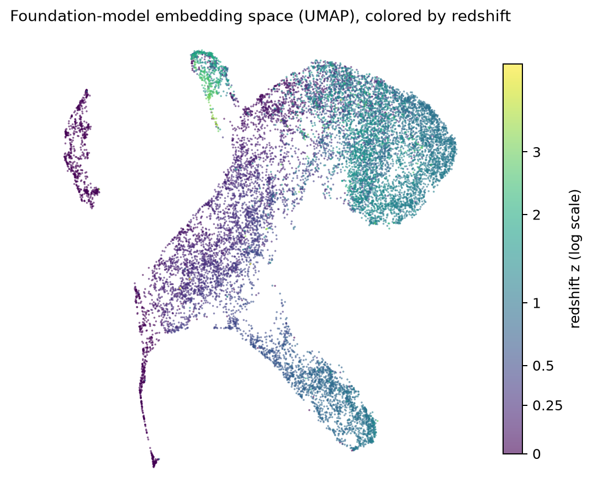

# spectra-copilot

[](https://github.com/Julian0444/spectra-copilot/actions/workflows/ci.yml)

LLM agent that analyzes astronomical spectra using the
[desi-fm](https://github.com/Julian0444/desi-spectra-fm) multitask transformer as a
tool — deterministic tools plus a Claude-API agent that calls the model,
cross-checks predictions with an emission-peak matching heuristic and writes
reports intended to cite tools and references. Citation IDs do not establish
scientific correctness. Every
tool returns compact JSON conclusions, never raw arrays.

**[🧠 The model: desi-spectra-fm](https://github.com/Julian0444/desi-spectra-fm)** ·
**[🤗 Checkpoint + FAISS index](https://huggingface.co/jirustaroure/desi-spectra-fm)** ·
**[▶ Model demo](https://huggingface.co/spaces/jirustaroure/desi-spectra-fm-demo)** ·
**[📡 Model REST API](https://jirustaroure-desi-fm-api.hf.space/api/docs)**

The 60-second version:

- **5 tools + agent + [MCP server](#use-it-from-any-mcp-client)** — redshift prediction,
  spectral-line verification, masked-reconstruction stability, FAISS semantic
  search over 15k spectra, and BM25 reference lookup with a citation contract.
- **[End-to-end evals on 150 held-out spectra](#end-to-end-evals-does-verification-actually-help-n--150)**
  with an honest headline: the bare model beats its own cheap-LLM agent
  (92.7 % vs 79.3 %). The agent's self-reported confidence tracks accuracy
  monotonically, so a hybrid "trust the agent only when it says *high*"
  policy gets back to 90.0 % (by avoiding breaks, not by recovering
  outliers). **The eval caught a deployment-relevant failure that four
  cherry-picked demos had hidden** — that is what evals are for.
- **[Mini-RAG with verified citations](#mini-rag-cited-references-bm25)** —
  every citation in every verified run matched a document actually retrieved
  in that conversation: 6/6 backed, 0 invented (checked by ID in the saved transcripts).
- **Tests cover tools, the agent contract, MCP, RAG and evaluation persistence.**
  Some integration tests require a local or previously cached checkpoint. They
  simulate the LLM; no paid API call is needed for tests. Historical structured
  evaluation cost was documented as US$4.06; that is not a current price quote.

Local consolidation, October 2026, pending publication. The negative historical
result remains authoritative for this version. The future product policy is to
preserve the model redshift; the current agent can still propose replacements.
Prompt facts, label clues and tool contracts remain work for later batches.

**Tools** (`copilot/tools.py`):

- `predict_redshift` — desi-fm v2.1 prediction: `z_pred_map` (official) +
  `z_confidence` + `z_pred` (`expm1(E[log(1+z)])` from the same classification posterior).
- `identify_spectral_lines` — detects emission peaks and checks whether known
  lines (Lyα … [SII]) land where a given z predicts; it also reports the
  strongest detected peaks, so the agent can derive alternative z hypotheses
  from an unexplained peak. This is a heuristic cross-check, not physical verification.
- `reconstruct_spectrum` — masks a fraction of the model's tokens and
  re-predicts, probing the stability of the prediction.
- `find_similar_spectra` — embeds the spectrum with the model's encoder and
  retrieves its nearest neighbors from a FAISS index of 15k DESI training
  spectra, each with its catalog redshift — another descriptive signal from the same supervised encoder ([details below](#semantic-search-embeddings--faiss)).
- `lookup_reference` (`copilot/rag.py`) — BM25 retrieval over a committed
  corpus of DESI reference notes + the extended line catalog, so the agent can
  ground its reasoning in citable priors — target-type z ranges, line
  visibility windows, classic degeneracies
  ([details below](#mini-rag-cited-references-bm25)).

## Quick start

```bash
# Development from matched source checkouts only: first install the current FM checkout.
# Archived 0.2.0 wheels certify batch 2 only and lack current modules.
# Definitive versions, wheels and clean installation acceptance belong to 5C.
pip install -e ".[dev]"
# optional: skip the ~104 MB Hub download by pointing at a local checkpoint
export DESI_FM_CKPT=/path/to/desi-spectra-fm/runs/desi_80k_classhead_v21/checkpoint_last.pt
pytest -q                                  # local/cached checkpoint needed by integration tests
python -m copilot eval/inputs-v2/spectrum_0001.npz
```

For external MCP clients, prepare opaque inputs with `scripts/derive_agent_inputs.py`
and keep its source map with the evaluator; see [BATCH_2.md](docs/BATCH_2.md).
Use the generated IDs in agent requests. The historical examples below retain
their original names and labels as evaluation evidence.

Without `DESI_FM_CKPT`, the public checkpoint is downloaded from
[jirustaroure/desi-spectra-fm](https://huggingface.co/jirustaroure/desi-spectra-fm)
and cached. The `examples/` spectra are historical DESI validation objects (excluded from v2.1 fine-tuning,
with strongly supported v1 exposure and checkpoint selection; not an independent test), each with its `z_true` for reference —
`examples/trap_single_line.npz` is the synthetic exception, see below.

Historical CLI output from contract v1 (`examples/heldout_z020.npz`, catalog z = 0.204). The current CLI omits labels and original paths and adds coverage/model identity:

```json
{
  "input": "examples/heldout_z020.npz",
  "predict_redshift": {
    "z_pred_map": 0.2267,
    "z_confidence": 0.6376,
    "z_pred": 0.2314
  },
  "identify_spectral_lines": {
    "z_tested": 0.2267,
    "n_peaks_detected": 64,
    "strongest_peaks_angstrom": [7900.8, 4488.0, 3644.0, 3740.0, 5852.0],
    "n_expected_in_coverage": 11,
    "n_matched": 2,
    "match_fraction": 0.18,
    "matched_lines": [
      {"line": "Hβ 4861", "lambda_expected": 5963.4, "matched_peak_at": 5968.8, "delta": 5.4},
      {"line": "[NII] 6583", "lambda_expected": 8076.0, "matched_peak_at": 8085.6, "delta": 9.6}
    ],
    "verdict": "weak_or_inconsistent"
  },
  "z_true_reference": 0.2036
}
```

Note what the line tool buys the agent: at the model's `z_pred_map = 0.2267`
only 2/11 lines match, but at the true `z = 0.2036` the same spectrum matches
**8/11 (`consistent`)** — and the strongest peak (7900.8 Å) read as Hα gives
exactly that z. This selected example illustrates the heuristic; it does not establish
discrimination against incorrect redshifts. Incorrect candidates can also receive
`consistent`. Matcher controls and acceptance are pending in 5B.

## The agent (Claude API)

`copilot/agent.py` drives Claude through the SDK tool runner: predict →
verify against lines → if `z_confidence < 0.3` or the match is weak, derive
alternative hypotheses from the strongest peaks and compare their
match_fractions before concluding; `find_similar_spectra` adds a
neighbor comparison from the same supervised encoder. (The four Opus reference
transcripts below predate `find_similar_spectra` and `lookup_reference` and
call only `predict_redshift` + `identify_spectral_lines`; the three
`*_rag.json` transcripts in the same folder, run with `claude-haiku-4-5`,
reflect the current 5-tool set and exercise both newer tools.)

```bash
# Set ANTHROPIC_API_KEY securely in your environment; never commit it.
python -m copilot.agent eval/inputs-v2/spectrum_0001.npz
python -m copilot.agent eval/inputs-v2/spectrum_0004.npz \
    --model claude-haiku-4-5 --save-transcript eval/runs/new-trap.json
```

Historically documented cost per analysis in this report mode, with the original 3-tool set
(`predict_redshift`, `identify_spectral_lines`, `reconstruct_spectrum`; token
usage is printed to stderr after each run): **`claude-opus-4-8`** (default) ≈
**$0.09–0.13**; **`claude-haiku-4-5`** ≈ **$0.013** — cheap enough to iterate
with, and it completes the full verify-then-refine loop too. With the five-tool set, a historical
Haiku report run cost ≈ $0.023 (as printed to stderr in the `*_rag.json`
runs; the transcripts themselves do not record usage), and
the structured eval mode averaged ≈ $0.027/case over 150 stratified spectra
([evals section](#end-to-end-evals-does-verification-actually-help-n--150)).
Full transcripts of the four reference runs (including every tool call and
result) are in [`eval/transcripts/`](eval/transcripts/).

### Historical demonstrations and their limits

The unedited reports remain in [`eval/transcripts/`](eval/transcripts/).
On `heldout_z020.npz`, the model gives 0.2267 versus catalog 0.2036:
normalized error ≈0.0192, already within the 0.15 tolerance. The Opus report
refines it to ≈0.204 but incorrectly calls the original a catastrophic error.
On z≈2.87, model error ≈0.110 is also within tolerance.

The single-line trap near 8,000 Å admits Hα at z≈0.219, [OIII] at z≈0.598
or [OII] at z≈1.146. Both saved outcomes must be considered:

| Saved run | Conditions | Outcome |
|---|---|---|
| [trap_single_line.json](eval/transcripts/trap_single_line.json) | `claude-opus-4-8`, original toolset; before FAISS/RAG | Reports indeterminate redshift and the competing assignments |
| [trap_rag.json](eval/transcripts/trap_rag.json) | `claude-haiku-4-5`, five tools including FAISS/RAG | Reports high confidence after testing incorrectly calculated alternatives; false certainty |

These are not controlled Opus/Haiku comparisons. In the second run the [OIII]
and [OII] alternatives were calculated as 0.5883 and 1.1769; from 7,999.6 Å
the correct values are approximately 0.5977 and 1.1464. Each correct assignment
matches one line; no unique solution follows.

For `heldout_lowconf_z157.npz`, Opus replaces error ≈0.24 with ≈0.16: both
are outliers at 0.15. Only Lyα is outside coverage at the catalog redshift;
other UV lines remain in-band. Filenames reveal catalog-redshift clues, so
these demonstrations are not blind evaluations. The prompt and tool issues
are documented for later consolidation batches, not fixed by these text edits.

## End-to-end evals: does verification actually help? (n = 150)

Hand-picked demos like the ones above are exactly what evals exist to keep
honest. `eval/` runs the **whole system** — agent + tools + desi-fm v2.1 —
against DESI pipeline redshifts on **150 real held-out spectra** (stratified:
45 in the z > 1.5 failure band; selection deterministic, seed 7, labels
asserted against the committed predictions CSV). Both systems answer the same
question per case; the agent finishes with a structured `submit_report`
(150/150 did — zero parsing, zero errors). Full methodology in
[`eval/README.md`](eval/README.md), raw results in
[`eval/results.csv`](eval/results.csv).

| system (protocol of the tools) | rate < 0.15 | rate < 0.05 | MAE_norm |
|---|---|---|---|
| desi-fm v2.1 alone | **92.7 %** | **77.3 %** | **0.061** |
| agent (`claude-haiku-4-5` + 5 tools + RAG) | 79.3 % | 72.0 % | 0.104 |
| hybrid: agent only when it reports `high` confidence | 90.0 % | — | — |

**The agent harms the measured result:** 139/150 successes for the model,
119/150 for the agent. It breaks 21 correct predictions, recovers 1 of 11
outliers and leaves 10 wrong. In z>1.5, model success is 41/45 versus 31/45.
Weak matcher confirmation is associated with the broken predictions; absent
full per-case traces and a controlled intervention, the mechanism remains a
hypothesis. Coverage alone has not been shown to explain the failures.

The sample is stratified (seed 7; quotas 40/35/30/25/10/10 across six z bins),
selected from the non-independent historical validation set. Both tools and
baseline use full spectra; the model card's 14.95% uses random 50% masking.
11/150 model errors is a measured 7.33% for this sample. Population reweighting
(6.54%) and paired-difference estimation (8.19%) are historical antecedents.
Batch 3 subsequently measured **240/2,000 = 12.00%** under the full-spectrum
v2 contract. It remains a non-independent historical diagnostic. It cannot
be compared to CNN’s 9.29% on the different 4B test, where v2.1 was not evaluated.

Neither confidence-based signal beats the model alone. Verbal confidence
orders historical success but is not a calibrated probability:

| agent confidence | n | rate < 0.15 |
|---|---|---|
| high | 63 | 88.9 % |
| medium | 70 | 77.1 % |
| low | 17 | 52.9 % |

17 of the 21 broken cases were self-flagged as medium/low. Second, that
signal is actionable: the hybrid row above (trust the agent only on `high`,
keep the model otherwise) gets back to 90.0 % — by avoiding 17 of the 21
breaks (the other 4 were reported `high`), not by recovering outliers: the
single outlier the agent did recover (`case_088`) came with `medium`
confidence, so the `high`-only gate hands it back to the model. The eval did
exactly what evals are for — it caught a deployment-relevant failure (don't
let this agent overrule the model on the basis of an unvalidated confidence policy) that four cherry-picked
demos had hidden.

Historically documented cost of the full run: **US$ 4.06** (150 agent analyses in the
structured mode — `run_structured`, 5 tools + `submit_report` —
`claude-haiku-4-5`, 3.27 M tokens ≈ 21.8 k/case ≈ $0.027/case; the report
mode of the demos above is cheaper per run, see
[The agent](#the-agent-claude-api)). The
model-only baseline needs no API and is reproducible with
`python eval/run_evals.py --baseline-only`.

## Semantic search (embeddings + FAISS)

The foundation-model encoder doubles as an **embedding model**: `desi_fm`'s
`embed_spectrum()` mean-pools the valid spectral tokens into a 512-d vector,
and `scripts/build_index.py` indexes 15k DESI training spectra
(L2-normalized → `faiss.IndexFlatIP`, i.e. cosine similarity). The index ships
on the [Hub](https://huggingface.co/jirustaroure/desi-spectra-fm/tree/main/faiss)
and is downloaded automatically on first use (~30 MB); the held-out `examples/`
are *not* in it by construction (it indexes the training side of the split).

A real query — the held-out galaxy at z_true = 0.204 whose official model
prediction was off (z_pred_map = 0.2267):

```json
{
  "k": 5, "index_size": 15000,
  "neighbors": [
    {"rank": 1, "similarity": 0.992, "z": 0.187},
    {"rank": 2, "similarity": 0.992, "z": 0.202},
    {"rank": 3, "similarity": 0.991, "z": 0.198},
    {"rank": 4, "similarity": 0.990, "z": 0.192},
    {"rank": 5, "similarity": 0.989, "z": 0.193}
  ],
  "neighbor_z_range": [0.187, 0.202], "neighbor_z_median": 0.193
}
```

The five nearest neighbors cluster tightly around the true redshift — evidence
from the same encoder trained with supervised redshift loss. It is not an
independent confirmation of the line-based hypothesis. The tool is equally
honest about failure modes: on the low-confidence outlier
(`heldout_lowconf_z157.npz`) the neighbor redshifts scatter across
[0.13, 1.39]. The synthetic single-line trap peaks at similarity 0.90 vs ~0.99
in these selected real examples. These are descriptive observations, not
validated distance thresholds or independent evidence of correctness.

The same embeddings, projected with UMAP and colored by catalog redshift:



The encoder was trained jointly with a supervised redshift loss. This UMAP of
15,000 training objects is descriptive; the gradient does not demonstrate
unsupervised discovery or transfer. Reproduce the plot with
`scripts/build_index.py` and `scripts/plot_umap.py` using the historical assets.

## Mini-RAG: cited references (BM25)

The agent's missing ingredient was *priors*: knowing that ELGs live at
0.6 < z < 1.6 turns "z_pred = 3.5 on an emission-line galaxy" from a number
into a red flag. `copilot/refs/` holds the installed corpus — `copilot/refs/lines.json`
(the 15-line catalog, extended with retrieval-friendly context: visibility
windows in DESI coverage, known confusions) plus 15 short notes on DESI
written from the public documentation (SV3, the BGS/LRG/ELG/QSO target
classes and their z ranges, Redrock, spectrograph coverage, sky residuals,
the single-line degeneracy), each carrying its `source:` URL on the first
line. `copilot/rag.py` indexes the ~30 documents with **BM25**
(`rank_bm25`) behind the `lookup_reference(query)` tool.

BM25 is a deliberate choice, not a placeholder: for ~30 short, technical
documents with controlled vocabulary, embeddings would add a model dependency (no recall comparison has been measured), while BM25 keeps retrieval deterministic, offline and
testable in CI. A real query:

```json
// lookup_reference("ELG redshift range", k=2)
{
  "results": [
    {"id": "desi-targets-elg", "source": "https://arxiv.org/abs/2208.08513",
     "snippet": "ELG (Emission Line Galaxy) targets are star-forming galaxies selected to lie at 0.6 < z < 1.6, the largest DESI target class. Their redshifts are measured primarily from the [OII] 3727 doublet, since Halpha has left the optical window above z = 0.49. ..."},
    {"id": "oii-doublet", "source": "https://arxiv.org/abs/2208.08513",
     "snippet": "The [OII] line is actually a doublet (3726.0 and 3728.8 A rest, ..."}
  ]
}
```

The system prompt closes the loop with a citation contract: when the agent
uses retrieved information it must cite the document id in square brackets
(`[desi-targets-elg]`, `[oii-doublet]`), and it may cite **only** ids
returned by `lookup_reference` in that conversation — never invent a
reference. `rag.valid_ids()` exposes the citable set so evals can verify
that no cited source was hallucinated. The classic failure the corpus
targets — `lookup_reference("Halpha OII confusion")` — retrieves the
single-line degeneracy note plus the `Halpha_6563` / `OII_3727` catalog
entries (pinned by a unit test).

**Verified on 3 real Haiku runs (~$0.07 total):** in every analysis the agent
consulted `lookup_reference` unprompted when the redshift was ambiguous, and
**all 6 citations across the 3 reports matched documents actually returned in
that conversation** — zero invented references (checked against
`rag.valid_ids()` and the transcripts in `eval/transcripts/*_rag.json`).
The low-confidence outlier report, verbatim (`claude-haiku-4-5`, $0.023 as printed to stderr in that run —
note how both citations do real work as priors):

> ## Observation report
>
> **Object:** examples/heldout_lowconf_z157.npz
>
> **Redshift:** Indeterminate; z_pred_map = 0.957 is unverified.
>
> **Evidence:**
>
> The foundation model prediction z_pred_map = 0.957 carries low confidence
> (0.181, well below the 0.3 threshold). Spectral-line verification at this
> redshift yields only 1 matched line (CIII] 1909) from 10 expected lines,
> match_fraction = 0.1 (identify_spectral_lines). This "weak_or_inconsistent"
> verdict is incompatible with a confident redshift claim.
>
> Alternative hypothesis z = 0.058 (derived by assuming the strongest peak
> 3944 Å is [OII] 3727) matches 2/11 lines and is equally weak. The 61
> detected peaks show no coherent signature of either redshift.
>
> The spectrum's nearest neighbors in the embedding space scatter widely
> (z = 0.129 to 1.386, median 0.937; find_similar_spectra), indicating the
> embedding is not distinctive—a sign the spectrum may be low
> signal-to-noise, ambiguous, or absorption-dominated.
>
> This spectrum's properties are consistent with an LRG (absorption-dominated,
> few emission lines; z_pred in the 0.4–1.1 LRG window **[desi-targets-lrg]**),
> but absorption-dominated spectra will inherently yield weak emission-line
> matches even at correct redshift **[absorption-dominated-spectra]**. The
> lack of strong, corroborating emission-line pairs (e.g. Hβ–[OIII] or [OII]
> doublet at consistent wavelengths) prevents secure redshift determination.
>
> **Confidence:** Very low. Neither z_pred_map nor alternative hypotheses
> exhibit >40% line-match fractions or tight neighbor clustering.
>
> **Notes:** The spectrum requires either higher signal-to-noise data or
> physical priors (photometry, host-galaxy morphology) to disambiguate. A
> robust absorption-feature-based redshift estimate (e.g. 4000 Å break,
> Ca H/K) would be more suitable for this object.

## Use it from any MCP client

`copilot/mcp_server.py` exposes the same five tools over the
[Model Context Protocol](https://modelcontextprotocol.io) (stdio transport),
so any MCP client — Claude Code, Claude Desktop, the `mcp dev` inspector —
can drive the foundation model directly. The client's LLM does the reasoning;
the tools only report measurements.

Register it in **Claude Code** (use the venv python so all deps resolve;
`DESI_FM_CKPT` is optional — without it the checkpoint is pulled from the Hub
on the first model call):

```bash
claude mcp add desi-fm \
    -e DESI_FM_CKPT=/path/to/checkpoint_last.pt \
    -- /path/to/spectra-copilot/.venv/bin/python \
       /path/to/spectra-copilot/copilot/mcp_server.py
claude mcp list   # desi-fm: ... - ✔ Connected
```

Or in **Claude Desktop**
(`~/Library/Application Support/Claude/claude_desktop_config.json`):

```json
{
  "mcpServers": {
    "desi-fm": {
      "command": "/path/to/spectra-copilot/.venv/bin/python",
      "args": ["/path/to/spectra-copilot/copilot/mcp_server.py"],
      "env": {"DESI_FM_CKPT": "/path/to/checkpoint_last.pt"}
    }
  }
}
```

Historical session (before batch 2; Claude Code driving the server on
`examples/heldout_z020.npz`, z_true = 0.204 — no agent code involved, just
the MCP tools and the client's own reasoning):

1. `predict_redshift` → `z_pred_map = 0.2267`, `z_confidence = 0.64`.
2. `identify_spectral_lines(z=0.2267)` → **weak** (2/11 lines,
   match_fraction 0.18): the peak-matching heuristic does not confirm the model.
3. `reconstruct_spectrum(mask_ratio=0.5)` → `z_pred_under_masking = 0.2031`,
   a notable swing — fragile evidence.
4. The client reads the strongest peak (7900.8 Å) as Hα and re-tests
   `z = 0.204` → **consistent** (8/11 lines, match_fraction 0.73, deltas
   < 2 Å).

Same detect-and-refine story as the agent's, reproduced by an off-the-shelf
MCP client: the tool descriptions alone are enough to steer the loop.
(`find_similar_spectra` was added after that session; called through the same
MCP layer on the same spectrum it returns the neighbor cluster shown in the
semantic-search section — z ∈ [0.187, 0.202] around the true 0.204.)

## Related

- Model: [desi-spectra-fm](https://github.com/Julian0444/desi-spectra-fm)
  (code) · [HF checkpoint](https://huggingface.co/jirustaroure/desi-spectra-fm)
  · [live demo](https://huggingface.co/spaces/jirustaroure/desi-spectra-fm-demo)
  · [REST API](https://jirustaroure-desi-fm-api.hf.space/api/docs)

## License and data

Code: [MIT, Julian Irusta Roure](LICENSE). DESI examples and derived data retain
their [CC BY 4.0 attribution, EDR citation and modification notices](ATTRIBUTIONS.md).

[Batch-1 execution and remaining limits](docs/BATCH_1.md).

Batch 2 contracts, opaque agent inputs, executable limits and local wheel installation: [BATCH_2.md](docs/BATCH_2.md). Historical examples and transcripts retain their original labels and protocols; the runner strips label-bearing metadata and paths before any LLM request.

Current consolidation: [batch 5A](docs/BATCH_5.md). v2.1 remains the default. Model-z protection and the explanatory policy are pending in 5B; current code still permits experimental agent replacements. Archived 0.2.0 wheels certify batch 2, not current source.
